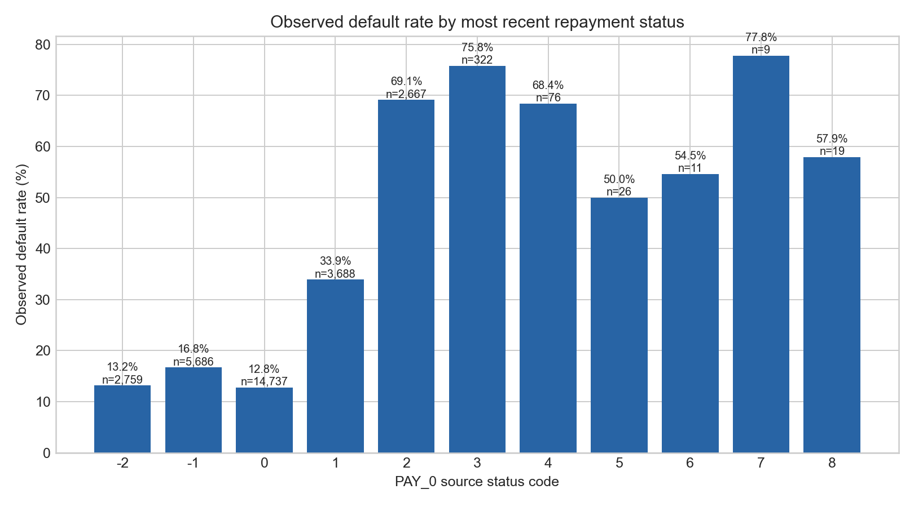
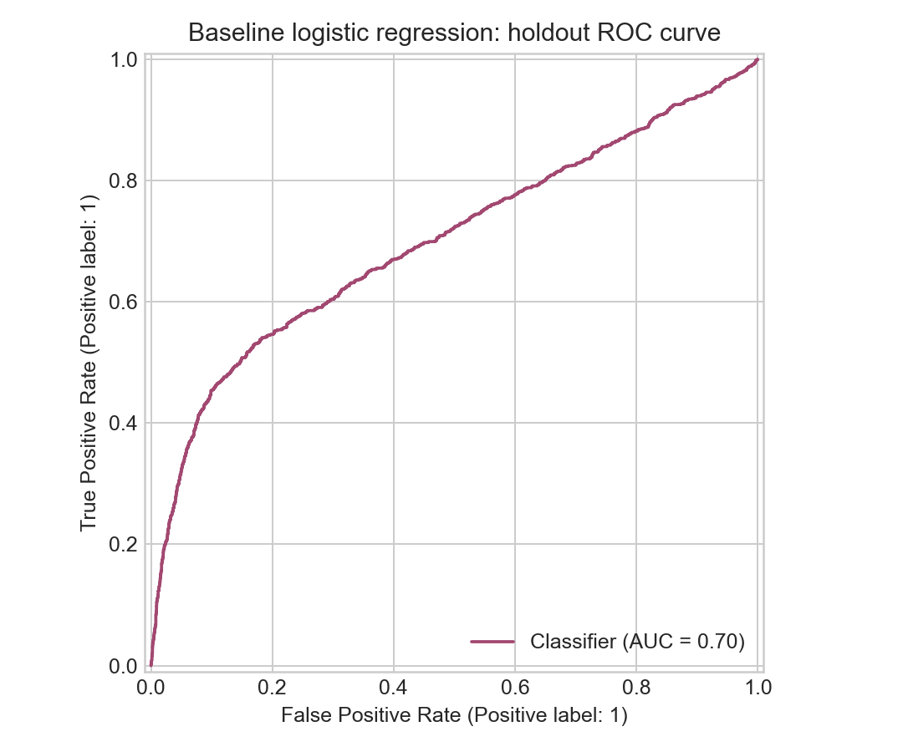

# Credit Risk: Understanding Repayment and Default Patterns

A reproducible credit-risk analytics project using the UCI **Default of Credit Card Clients** dataset. It combines data cleaning, SQL analysis, exploratory analysis, and an interpretable baseline model to answer a practical question:

> Which repayment patterns are associated with next-month default, and how should a risk team use that evidence responsibly?

## What this project demonstrates

- A repeatable data ingestion and cleaning workflow
- Business questions answered in SQL with DuckDB
- Exploratory analysis with Python, pandas, and matplotlib
- A logistic-regression baseline with a stratified holdout set
- Evaluation beyond accuracy: ROC AUC, precision, recall, F1, and confusion matrix
- A small Streamlit dashboard for exploring the prepared data
- Clear documentation of limitations, responsible use, and source attribution

## Key questions

1. How does the observed default rate change with recent repayment status?
2. How do default rates vary across credit-limit bands and age bands?
3. What share of customers have delayed payments in multiple recent months?
4. How well does a transparent logistic-regression baseline rank default risk?

## Quick start

Requires Python 3.9 or newer.

```bash
python -m venv .venv
source .venv/bin/activate  # Windows: .venv\Scripts\activate
pip install -r requirements.txt
python scripts/run_analysis.py
streamlit run app.py
```

The first command downloads the dataset from the UCI Machine Learning Repository. The raw file is kept locally under `data/raw/` and is not committed to Git. The analysis writes cleaned data, CSV summaries, figures, and model metrics beneath `data/processed/` and `reports/`.

To run only the analysis after downloading the data:

```bash
python scripts/run_analysis.py --skip-download
```

## Repository layout

```text
.
├── app.py                    # Interactive Streamlit dashboard
├── data/
│   ├── raw/                   # Downloaded source data (git-ignored)
│   └── processed/             # Reproducible analysis outputs (git-ignored)
├── reports/
│   └── figures/               # Generated figures and model evaluation plot
├── scripts/
│   ├── download_data.py       # Fetches the official UCI dataset
│   └── run_analysis.py        # Cleans, analyzes, models, and exports results
├── sql/                       # Standalone DuckDB business questions
└── requirements.txt
```

## Dataset and definitions

The dataset contains 30,000 credit-card clients in Taiwan and 23 explanatory variables, with a binary label for default payment in the following month. It includes demographic fields, credit limit, repayment status over six months, bill statements, and prior payments. The outcome is `default_payment_next_month`.

**Observed default rate** means the share of rows labeled as default in this historical sample. It is not a forecast for a present-day customer or a calibrated probability. `PAY_0` is the repayment status in September 2005; positive values indicate months of delay, `-1` means payment was made duly, `0` means revolving credit was used, and `-2` means there was no consumption. Other negative values are preserved as recorded by the source.

Source: Yeh, I. (2009). *Default of Credit Card Clients* [Dataset]. UCI Machine Learning Repository. https://doi.org/10.24432/C55S3H. Licensed CC BY 4.0. See [UCI dataset page](https://archive.ics.uci.edu/dataset/350/defaultofcreditcardclients).

## Analysis approach

- Exclude the source workbook's row-number field; preserve the client ID only for record-level traceability and do not use it as a model feature.
- Validate required columns, target values, and missingness before analysis.
- Keep the original repayment-status codes. Do not silently reinterpret special negative codes as actual delinquency.
- Use a stratified 80/20 train/test split and a scikit-learn pipeline with median imputation, max-absolute scaling, and logistic regression.
- Report the default-class precision and recall at the default 0.50 threshold, along with ROC AUC. The threshold is a simple baseline choice, not an operational policy.
- Group-rate comparisons are descriptive and do not establish causality.

## Results from the reproducible run

The 30,000-row sample has a **22.1% observed next-month default rate**. The observed rate is higher among records with a positive recent delay code: for example, it is about **12.8%** for `PAY_0 = 0`, **33.9%** for `PAY_0 = 1`, and **69.1%** for `PAY_0 = 2`. These groups are descriptive and their rates can be noisy at the rare-code end. The holdout logistic-regression baseline reached **0.700 ROC AUC**; at the 0.50 threshold, recall for the default class was **20.5%**. This makes the threshold tradeoff visible: accuracy alone would hide many missed defaults.

The regenerated charts are included below. Exact metrics are in `reports/analysis_summary.md`.





## Responsible use and limitations

This dataset is historical, geographically specific, and not representative of today's applicants or lending environments. Demographic variables can encode sensitive attributes. The model is included only as a learning baseline; it is not suitable for credit decisions, underwriting, pricing, or customer action. A real deployment would need contemporary data, documented target and population definitions, leakage checks, calibration, subgroup performance and fairness review, explainability, governance, legal review, and ongoing monitoring. Group differences in this analysis should not be read as causal effects.

The randomly stratified holdout gives a reproducible benchmark on this dataset, but it does not measure performance under time drift or population shift.

## Reproduce and inspect

After running the pipeline:

- `reports/analysis_summary.md` gives the headline sample statistics and model scores.
- `reports/figures/` contains the generated plots.
- `data/processed/credit_clients_clean.csv` is the cleaned table.
- `sql/analysis.sql` contains portable DuckDB queries for the main business questions.

## License

Project code: MIT License (see `LICENSE`). The source dataset has its own CC BY 4.0 license and attribution requirements; it is downloaded separately and is not included in this repository.
